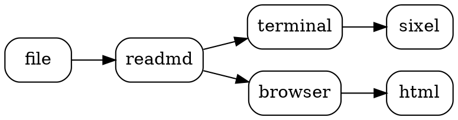

+++
title = "Diagram zoo"
author = "readmd"
date = "2026-01-01"
tags = ["diagrams", "kroki", "samples"]
+++

# Diagram zoo

Every fence below is a diagram kind readmd understands. Mermaid, D2, Graphviz and PlantUML use a
local tool when one is installed; **everything else is rendered by [Kroki](https://kroki.io)**
(the diagram text is sent to the server — set `krokiUrl` to self-host, or run with `--offline`
to see the sources instead). Press `s` on any diagram to flip between the image and its source,
`v` to zoom into it, `y` to copy the source.

This file also has **TOML front matter** (`+++`), rendered as the header above.

## Text-first tools

### ditaa

```ditaa
+--------+   +-------+    +-------+
|        | --+ ditaa +--> |       |
|  Text  |   +-------+    |diagram|
|Document|   |!magic!|    |       |
|     {d}|   |       |    |       |
+---+----+   +-------+    +-------+
    :                         ^
    |       Lots of work      |
    +-------------------------+
```

### svgbob

```svgbob
       .---.
      /-o-/--
   .-/ / /->
  ( *  \/
   '-.  \
      \ /
       '
```

### Pikchr

```pikchr
arrow right 200% "Markdown" "Source"
box rad 10px "Markdig" "Parser" fit
arrow right 200% "AST" ""
box same "Layout" "Engine" fit
arrow right 200% "Lines" ""
box same "Terminal" "Output" fit
```

### nomnoml

```nomnoml
[<frame>Pipeline|
  [Document] -> [Parser]
  [Parser] -> [Layout]
  [Layout] -> [Screen]
  [Layout] -> [Export|html;pdf]
]
```

## Structured data

### Entity relationship (erd)

```erd
[Person]
*name
height
weight
+birth_location_id

[Location]
*id
city
state
country

Person *--1 Location
```

### DBML

```dbml
Table users {
  id integer [primary key]
  username varchar
  created_at timestamp
}

Table posts {
  id integer [primary key]
  title varchar
  user_id integer
}

Ref: posts.user_id > users.id
```

### WaveDrom (timing)

```wavedrom
{ "signal": [
  { "name": "clk",  "wave": "p......." },
  { "name": "req",  "wave": "0.1..0.." },
  { "name": "ack",  "wave": "0..1..0." },
  { "name": "data", "wave": "x.==.=x.", "data": ["head", "body", "tail"] }
]}
```

### Bytefield

```bytefield
(defattrs :bg-green {:fill "#a0ffa0"})
(defattrs :bg-yellow {:fill "#ffffa0"})
(draw-column-headers)
(draw-box "Address" {:span 4})
(draw-box "Size" {:span 2})
(draw-box 0 {:span 2})
(draw-gap "Payload" :bg-green)
(draw-bottom)
```

### Vega-Lite

```vegalite
{
  "$schema": "https://vega.github.io/schema/vega-lite/v5.json",
  "description": "Diagrams rendered per week",
  "data": { "values": [
    {"week": "W1", "count": 12}, {"week": "W2", "count": 19},
    {"week": "W3", "count": 31}, {"week": "W4", "count": 27}
  ]},
  "mark": "bar",
  "encoding": {
    "x": {"field": "week", "type": "ordinal"},
    "y": {"field": "count", "type": "quantitative"}
  }
}
```

## blockdiag family

### blockdiag

```blockdiag
blockdiag {
  Markdown -> Parse -> Layout -> Draw;
  Layout -> Highlight;
  Highlight -> Draw;
}
```

### seqdiag

```seqdiag
seqdiag {
  viewer -> renderer [label = "RenderAsync"];
  renderer -> kroki [label = "POST /svg"];
  renderer <-- kroki [label = "SVG"];
  viewer <-- renderer [label = "PNG"];
}
```

### actdiag

```actdiag
actdiag {
  open -> parse -> layout -> paint;
  lane user { label = "User"; open; }
  lane readmd { label = "readmd"; parse; layout; paint; }
}
```

### packetdiag

```packetdiag
packetdiag {
  colwidth = 32;
  node_height = 72;
  0-15: Source Port;
  16-31: Destination Port;
  32-63: Sequence Number;
  64-95: Acknowledgment Number;
}
```

## Also via Kroki when no local tool is found

### Graphviz (`dot`)



### PlantUML C4

```c4plantuml
@startuml
!include <C4/C4_Container>
Person(reader, "Reader", "Someone with a Markdown file")
System_Boundary(readmd, "readmd") {
  Container(tui, "Terminal UI", ".NET", "Renders in the terminal")
  Container(web, "Browser mode", "Kestrel", "Full-fidelity view")
}
System_Ext(kroki, "Kroki", "Diagram rendering service")
Rel(reader, tui, "Uses")
Rel(reader, web, "Opens with --browser")
Rel(tui, kroki, "Renders exotic diagrams", "HTTPS")
@enduml
```

### Mermaid, in an Azure DevOps container

::: mermaid
stateDiagram-v2
  [*] --> Pending
  Pending --> Rendering: request
  Rendering --> Ready: png
  Rendering --> Failed: error
  Failed --> Rendering: retry
  Ready --> [*]
:::

## What happens when a diagram fails

```mermaid
graph TD
  A[This diagram has a syntax error ---> B
```

The error is shown inline together with the source, never a blank gap — and `:source` / `s`
shows the text for any diagram.
