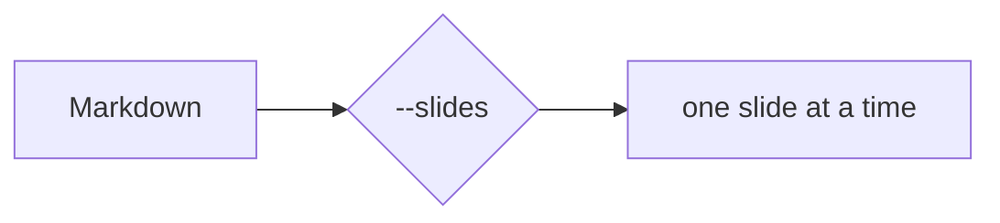

# readmd in presentation mode

Run `readmd samples/slides.md --slides` — or press **Ctrl+S** in any document.

<!-- notes: Welcome everyone. This deck demonstrates slide mode; the notes you are reading are speaker notes shown with N. -->

---

## Slides are plain Markdown

- A `---` thematic break (with a blank line before it) starts a new slide
- So does an explicit `<!-- slide -->` comment
- Everything you can render normally works here: tables, code, diagrams, math

<!-- pause -->

- `<!-- pause -->` reveals the slide step by step

<!-- pause -->

- `n` / `Space` / `→` advance, `p` / `←` go back, `5gg` jumps to slide 5

---

## Code and diagrams

```csharp
var deck = SlideDeck.Split(markdown);
Console.WriteLine($"{deck.Count} slides");
```



<!-- notes
Multi-line notes work too.
Mention that diagrams render exactly as in the document view.
-->

<!-- slide -->

## Not a separator

Setext headings use dashes without a blank line above:

A setext heading
---

…and that is still part of this slide. Fenced code is safe as well:

```
---
<!-- slide -->
```

???

Remark-style notes: everything after a `???` line is a speaker note.

---

## That's it

Press **Ctrl+S** to return to the document, `N` for notes, `q` to quit.
